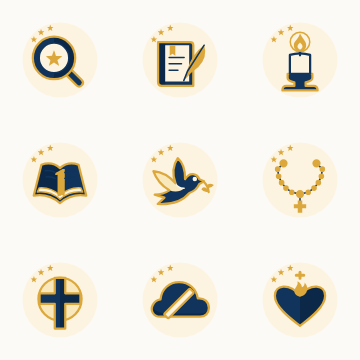
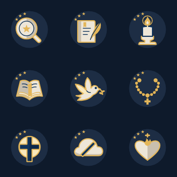

# Catholic1 · Medallas de marca (T-070)

Nueve ilustraciones genéricas, creadas por Chaty (IA) el 28-11-2026. Segunda dirección de arte de P6: formas planas rellenas, filete dorado, medallón de 400 px y arco común de tres estrellas de la corona original.

Cada motivo tiene dos SVG maestros de 512 × 512, Día (`-day.svg`) y Noche (`-night.svg`), y cuatro PNG transparentes a 288 y 384 px. La geometría es idéntica entre temas. Los SVG usan grupos y paths; cada grupo contiene un único color, y los filetes se dibujan como trazos separados sobre las sombras. Los sufijos numéricos distinguen grupos del mismo rol que necesitan distinto orden de pintado; `details`, `warm`, `wick` y `thread` distinguen los detalles y excepciones de color.
| Motivo | Día | Noche |
|---|---|---|
| empty-search | [SVG](empty-search-day.svg) · [3×](empty-search-day-288.png) · [4×](empty-search-day-384.png) | [SVG](empty-search-night.svg) · [3×](empty-search-night-288.png) · [4×](empty-search-night-384.png) |
| empty-journal | [SVG](empty-journal-day.svg) · [3×](empty-journal-day-288.png) · [4×](empty-journal-day-384.png) | [SVG](empty-journal-night.svg) · [3×](empty-journal-night-288.png) · [4×](empty-journal-night-384.png) |
| empty-candle | [SVG](empty-candle-day.svg) · [3×](empty-candle-day-288.png) · [4×](empty-candle-day-384.png) | [SVG](empty-candle-night.svg) · [3×](empty-candle-night-288.png) · [4×](empty-candle-night-384.png) |
| empty-book | [SVG](empty-book-day.svg) · [3×](empty-book-day-288.png) · [4×](empty-book-day-384.png) | [SVG](empty-book-night.svg) · [3×](empty-book-night-288.png) · [4×](empty-book-night-384.png) |
| empty-dove | [SVG](empty-dove-day.svg) · [3×](empty-dove-day-288.png) · [4×](empty-dove-day-384.png) | [SVG](empty-dove-night.svg) · [3×](empty-dove-night-288.png) · [4×](empty-dove-night-384.png) |
| empty-rosary | [SVG](empty-rosary-day.svg) · [3×](empty-rosary-day-288.png) · [4×](empty-rosary-day-384.png) | [SVG](empty-rosary-night.svg) · [3×](empty-rosary-night-288.png) · [4×](empty-rosary-night-384.png) |
| empty-cross | [SVG](empty-cross-day.svg) · [3×](empty-cross-day-288.png) · [4×](empty-cross-day-384.png) | [SVG](empty-cross-night.svg) · [3×](empty-cross-night-288.png) · [4×](empty-cross-night-384.png) |
| error-offline | [SVG](error-offline-day.svg) · [3×](error-offline-day-288.png) · [4×](error-offline-day-384.png) | [SVG](error-offline-night.svg) · [3×](error-offline-night-288.png) · [4×](error-offline-night-384.png) |
| empty-heart | [SVG](empty-heart-day.svg) · [3×](empty-heart-day-288.png) · [4×](empty-heart-day-384.png) | [SVG](empty-heart-night.svg) · [3×](empty-heart-night-288.png) · [4×](empty-heart-night-384.png) |

### Láminas

Día sobre `#FCFAF6`, Noche sobre `#0E1A2B`. Cada ilustración tiene 96 × 96 px en la rejilla de 360 × 360 px (referencia a densidad 1×). La fila de marca conserva esas dimensiones y añade el símbolo original a 46 × 46 px.

[Comparación con el símbolo · Día](_brand-day.png) · [Comparación con el símbolo · Noche](_brand-night.png)

### Paleta y contraste

El fondo del medallón cambia de `#FCF4E0` a `#1D2D44`. Tras la revisión 1, se aplica la opción b de Noche: cuerpo `#EDE6D8`, segundo plano `#C9BFAE`, detalles `#10345C`, oro `#E3B65A`. El nimbo conserva `#F8E8BC`, la mecha de Noche usa ese mismo tono y el hilo del rosario `#B47C20`. Día conserva marino `#10345C`, sombra `#0C2848` y oro `#DCA83C`.

Contraste de Noche: cuerpo/medallón 11,19:1; detalles/cuerpo 10,14:1; detalles/sombra 6,92:1. Los filetes de 12 px están sobre los rellenos y sombras. Las estrellas de Día son decorativas. No se añaden brillos, degradados ni figuras humanas.
Fuente de estilo: [símbolo Catholic1](../../source/Catholic1-logo.svg), renders y [especificación](../../../CATHOLIC1.md). Las estrellas y la cinta del libro reutilizan directamente geometría vectorial del símbolo original, adaptada a escala; el rosario toma la disposición colgante simplificada del logo.

Revisión 2: excepciones aprobadas para la revisión de contraste: cruz marina en ambos temas, barra sin conexión marina de Noche; cuerpo de paloma navy y detalles invertidos. El rosario de Día conserva el oro limpio por decisión del dueño.
