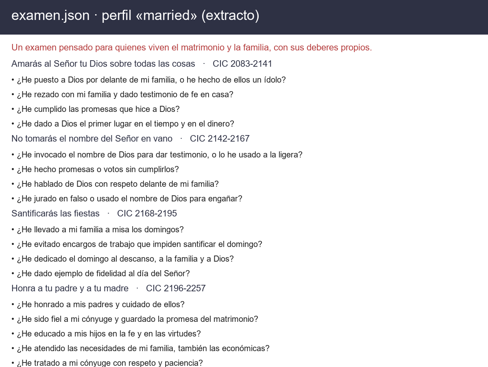
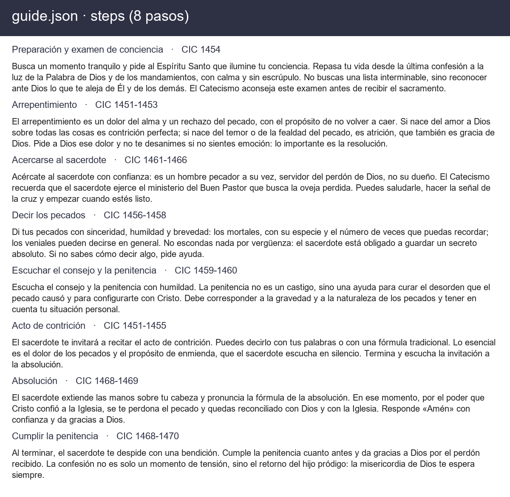
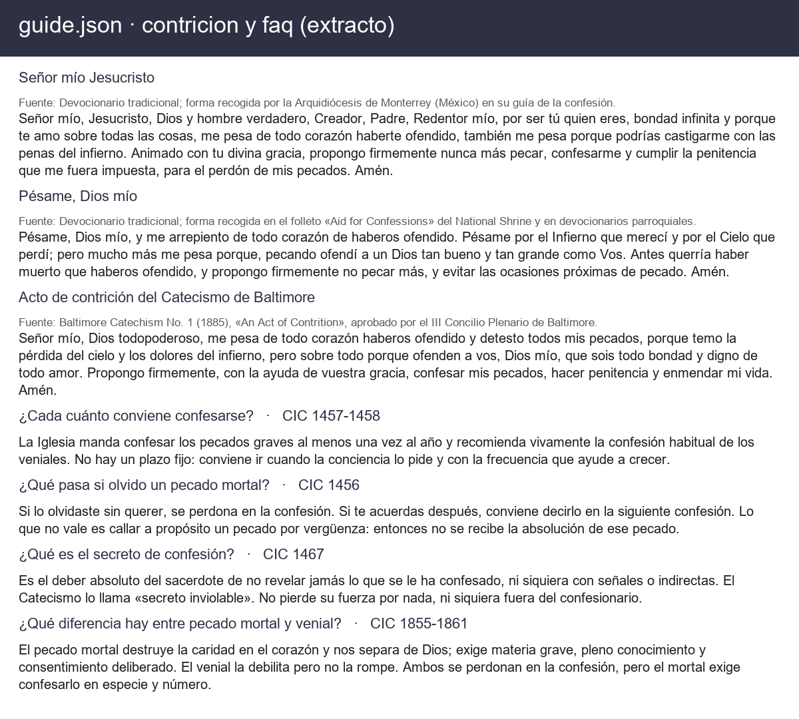

# T-027 · Contenido para «Confesión»: examen de conciencia y guía del sacramento

- **Asignado:** Hermes · **Rama:** `ext/T-027` (fork) · **Estado:** ABIERTO, entregado.
- **Archivos creados:** `app/src/main/assets/confession/examen.json`,
  `app/src/main/assets/confession/guide.json`,
  `docs/tasks/tools/validate_confession.py`, `docs/tasks/T-027-REPORT.md`.
- No se tocó ningún otro archivo.

## Qué hice

Contenido para la futura pantalla de Confesión (M12). Solo datos; la pantalla se hará después.
No se ha añadido ni modificado ninguna interfaz, por eso las capturas son **previsualizaciones del
contenido**, no pantallas de la app.

### `examen.json`

Cinco perfiles (`children`, `youth`, `married`, `single`, `consecrated`), cada uno con las
**12 secciones**: los Diez Mandamientos, los preceptos de la Iglesia y las obras de misericordia y
deberes del propio estado.

| Sección | Título | `basis` |
|---|---|---|
| `c1` | Amarás al Señor tu Dios sobre todas las cosas | CIC 2083-2141 |
| `c2` | No tomarás el nombre del Señor en vano | CIC 2142-2167 |
| `c3` | Santificarás las fiestas | CIC 2168-2195 |
| `c4` | Honra a tu padre y a tu madre | CIC 2196-2257 |
| `c5` | No matarás | CIC 2258-2330 |
| `c6` | No cometerás adulterio | CIC 2331-2400 |
| `c7` | No robarás | CIC 2401-2463 |
| `c8` | No darás falso testimonio | CIC 2464-2513 |
| `c9` | No consentirás pensamientos ni deseos impuros | CIC 2514-2533 |
| `c10` | No codiciarás los bienes ajenos | CIC 2534-2557 |
| `church` | Preceptos de la Iglesia | CIC 2041-2043 |
| `mercy` | Obras de misericordia y deberes del propio estado | CIC 2447 |

**244 preguntas** en total (4 o 5 por sección), en ES/EN/PT. Las preguntas se adaptan al perfil:
los niños reciben preguntas sencillas y concretas; los casados, deberes conyugales y familiares;
los consagrados, los votos y el carisma.

### `guide.json`

- **`steps`**: 8 pasos (preparación y examen, arrepentimiento, acercarse al sacerdote, decir los
  pecados, escuchar el consejo y la penitencia, acto de contrición, absolución, cumplir la
  penitencia), de 40 a 90 palabras por idioma, cada uno con su base del CIC.
- **`contrition`**: 3 actos de contrición tradicionales **reales**, con su texto y su fuente:
  1. «Señor mío Jesucristo» — devocionario tradicional, forma recogida por la Arquidiócesis de
     Monterrey (México).
  2. «Pésame, Dios mío» — devocionario tradicional, forma recogida en el folleto *Aid for
     Confessions* del National Shrine y en devocionarios parroquiales.
  3. «Act of Contrition» del **Baltimore Catechism No. 1** (1885), aprobado por el III Concilio
     Plenario de Baltimore.
- **`faq`**: 9 preguntas frecuentes con respuesta breve y su número del CIC (frecuencia, pecado
  olvidado, secreto de confesión, pecado mortal y venial, perdón sin sacerdote, número de veces,
  penitencia, recaer, comulgar en pecado mortal).

### Regla de contenido

- **Nada de oraciones nuevas**: los tres actos de contrición se reproducen fielmente de las
  fuentes citadas; las versiones EN/PT del primero y del segundo son traducción fiel, y el tercero
  es el texto del Baltimore Catechism. Ningún texto del Ritual de la Penitencia ni la fórmula de
  absolución: se describe qué ocurre.
- **Redacción propia** en el examen y en la guía, fiel al Catecismo. Tono pastoral y sereno, sin
  escrúpulo ni morbosidad: no hay listas detalladas de pecados sexuales, solo formulaciones
  sobrias como las de los exámenes diocesanos.
- **Sin diagnóstico**: se invita a la confianza en la misericordia (CIC 1422-1484) y se remite al
  confesor cuando algo lo pide.

## Validación

```bash
$ python docs/tasks/tools/validate_confession.py \
      app/src/main/assets/confession/examen.json \
      app/src/main/assets/confession/guide.json
examen.json: 5 perfiles · 60 secciones · 244 preguntas
guide.json: 8 pasos · 3 actos de contrición · 9 preguntas
0 errors · 0 warnings
```

El script (dejado en `docs/tasks/tools/validate_confession.py`) comprueba que el JSON sea válido,
que los cinco perfiles tengan 12 secciones o más, que cada pregunta tenga `es`/`en`/`pt` no
vacíos y que cada `basis` siga el formato `CIC n` o `CIC n-m` con números entre 1 y 2865. Además
avisa si un paso de la guía sale del rango de 40–90 palabras.

## Fuentes

- **Catecismo de la Iglesia Católica**, texto de la app (`CatechismFullData*.kt`, 2865 párrafos;
  procedencia en `docs/content/catechism-provenance.json`). Se comprobaron uno a uno los rangos
  citados: el Decálogo (2083-2557), los preceptos de la Iglesia (2041-2043), las obras de
  misericordia (2447) y la doctrina del sacramento (1422-1484, 1450-1460, 1480-1484).
- **Baltimore Catechism No. 1** (1885), «An Act of Contrition»:
  https://archive.org/stream/baltimorecatechi14551gut/14551.txt
- **Devocionario tradicional** («Pésame, Dios mío»), recogido en el folleto *Aid for Confessions*
  del National Shrine: https://www.nationalshrine.org/wp-content/uploads/Aid-Confessions-Spanish-2025-v2.pdf
- **Arquidiócesis de Monterrey**, guía de la confesión (forma «Señor mío, Jesucristo»):
  https://www.arquidiocesismty.org/arquimty/un-unguento-para-sanar-las-heridas-de-mis-pecados/
- **Vaticannews**, «Acto de Contrição» (Biblioteca Apostólica Vaticana), para la versión
  portuguesa: https://www.vaticannews.va/pt/oracoes/acto-de-contricao.html

## Capturas (previsualización del contenido)







## Lo que no se pudo verificar

- La pantalla de Confesión no existe todavía: no hay capturas de la app ni comprobación en
  dispositivo. El coordinador la integrará y hará las capturas finales.
- Los dos primeros actos de contrición existen en varias impresiones ligeramente distintas;
  se reproduce una forma diócesana y se indica la fuente. No se ha fijado un impresor concreto.
- No se ha compilado la app: no hay Android SDK en este equipo.

## Preguntas para el coordinador

1. ¿Quieres que el `examen.json` lleve un `source` por sección (fuente diocesana concreta del
   texto reformulado) o basta con el `basis` del CIC?
2. El contrato de la pantalla no está publicado (`docs/content/` no tiene especificación de
   M12). ¿La hago yo o la define el coordinador? Si la defines, dime los campos que debe
   mostrar la pantalla y ajusto el JSON.
